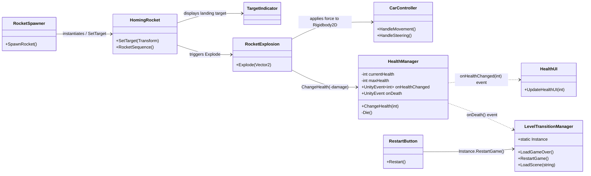

# Explosive Drive!
 
**Dodge rockets, drones, and obstacles to reach your destination!**

Explosive Drive! is a 2D arcade driving game made in **Unity**. The player controls a car, avoids incoming threats, and tries to survive until reaching the destination. Rockets target the player, fall toward an indicated location, and create explosions that can push, rotate, and damage the car.

## Assingment Requirements Used:
- AddForce and AddTorque for the movement of the player
## Running the game

### From the Unity Editor

1. Clone or download this repository.
2. Open **Unity Hub** → **Add project from disk**, and select the folder containing `Assets`, `Packages`, and `ProjectSettings`.
3. Open the project using the Unity version specified in `ProjectSettings/ProjectVersion.txt` (or allow Unity Hub to install it).
4. Open the main gameplay scene from `Assets/Scenes/` (check the actual scene filename in the repository).
5. Press **Play** in the Editor.

### Building and running in a browser

1. Open **File → Build Profiles** in Unity.
2. Select or create a **Web** build profile, and install the Web Build Support module if prompted.
3. Add the gameplay and `GameOverScreen` scenes to the active build profile's scene list; ensure their names match the scene names configured on `LevelTransitionManager`.
4. Select **Build and Run** to test locally, or **Build** to generate the web output.
5. For itch.io, ZIP the **contents** of the Web build output so that `index.html` is at the ZIP root, upload the ZIP as an HTML game, and enable **This file will be played in the browser**.

> Opening `index.html` directly from disk may not work for Unity Web builds. Use **Build and Run** or serve the output over HTTP.

### Controls

The controls are defined by the project's Unity Input System bindings and car controller. **Document the actual steering, acceleration, braking, and other bindings here before release.**

## Architecture

The game separates vehicle control, enemy behavior, collision effects, health, presentation, and scene transitions.

### Event senders and listeners

| Sender | Event / call | Listener | Result |
| --- | --- | --- | --- |
| `RocketExplosion` | Calls `HealthManager.ChangeHealth(-damage)` | `HealthManager` | Reduces HP if the explosion reaches the car and is not blocked by cover |
| `HealthManager` | **`onHealthChanged(int)` UnityEvent** | `HealthUI.UpdateHealthUI(int)` | Updates the color of health icons |
| `HealthManager` | **`onDeath()` UnityEvent** | `LevelTransitionManager.LoadGameOver()` | Loads the Game Over scene when HP reaches zero |
| Restart UI button | `Button.onClick` | `RestartButton.Restart()` | Calls the singleton to reload the gameplay scene |

The two `HealthManager` UnityEvents are wired on the **Player GameObject in the Inspector**. For health updates, select the **Dynamic int** overload of `HealthUI.UpdateHealthUI(int)` so it receives the actual HP value.

### Gameplay flow

1. `RocketSpawner` creates a rocket and assigns its player target.
2. `HomingRocket` shows a `TargetIndicator`, then carries out its attack sequence.
3. `RocketExplosion.Explode()` queries nearby 2D colliders, checks for blocking cover, and applies an impulse to eligible rigidbodies.
4. For a damaged car, the explosion calls `HealthManager.ChangeHealth(-explosionDamage)`.
5. `HealthManager` invokes `onHealthChanged`, updating the icons through `HealthUI`.
6. When HP reaches zero, `HealthManager.Die()` invokes `onDeath`, which loads the Game Over scene.
7. The Restart button uses `LevelTransitionManager` to reload the gameplay scene.

## Design decisions and alternatives

### 1. UnityEvents for health and death notifications

**Chosen:** `HealthManager` exposes `onHealthChanged(int)` and `onDeath()` as Inspector-configurable UnityEvents.

**Alternative:** C# events (`event Action<int>`) with listeners subscribed in `OnEnable` and unsubscribed in `OnDisable`.

**Reason:** UnityEvents make it easy to connect the UI and scene transition without hard-coding those dependencies into `HealthManager`. C# events provide stronger code-level control and are useful for more complex systems, but require explicit subscription management. A tradeoff is that UnityEvent connections can silently break if objects or methods are renamed; test the Inspector bindings after refactors.

### 2. Separate explosion physics from health management

**Chosen:** `RocketExplosion` determines which objects are hit, whether cover blocks the blast, and how much force to apply; `HealthManager` owns HP and death behavior.

**Alternative:** Store HP and death logic directly in the rocket or explosion script.

**Reason:** Separating these concerns allows multiple hazards to use the same health system and makes explosion behavior independently tunable. The `HashSet<Rigidbody2D>` prevents duplicate physics impulses to the same rigidbody within one blast. A `HashSet<HealthManager>` can similarly guard against duplicate damage if the collision-handling logic changes.

### 3. Centralized scene transitions through a singleton

**Chosen:** `LevelTransitionManager` exposes a static `Instance` and persists across scene loads using `DontDestroyOnLoad`.

**Alternative:** Each scene owns a local transition manager, or scenes are loaded directly from individual gameplay and UI scripts.

**Reason:** A single transition manager provides a consistent entry point for loading Game Over and restarting. Persistence makes it accessible after the gameplay scene unloads. The tradeoff is global state and initialization-order dependence; duplicate managers must be destroyed in `Awake`, and a scene launched independently must initialize the manager before it is used.

## Extending the game

### Adding a new enemy

The precise files depend on whether the enemy reuses rocket behavior or introduces a new attack. Typical changes are:

| File / asset | Change |
| --- | --- |
| **New enemy prefab** | Create the sprite, collider, rigidbody (if needed), and components |
| **New enemy behavior script** (for example `DroneEnemy.cs`) | Implement movement, targeting, and attack logic |
| `RocketSpawner.cs` **or a new spawner** | Add the new prefab to the spawn system, or create a dedicated spawner |
| `RocketExplosion.cs` **if reused** | Configure damage, radius, force, and layer masks on the prefab; edit the script only if new explosion behavior is required |
| `HealthManager.cs` | **Usually no change** if the enemy damages the player using `ChangeHealth(-amount)` |
| Scene / level configuration | Place or configure enemy spawns and balance their frequency |

For example, a drone could move toward the player and call `HealthManager.ChangeHealth(-1)` when it attacks. It would not need to know how the health UI or Game Over scene works.

### Adding a new item (extension point)

A general item/inventory system has **not been established** in the current architecture. For a simple health pickup, the likely changes are:

| File / asset | Change |
| --- | --- |
| **New pickup prefab** | Add a sprite and a 2D trigger collider |
| **New pickup script** (for example `HealthPickup.cs`) | Detect the player, call `HealthManager.ChangeHealth(+1)`, then remove the pickup |
| Scene / spawn configuration | Place the item or add it to an item spawner |
| `HealthManager.cs` | **No change** for a simple healing item; `ChangeHealth` already supports positive amounts |
| `HealthUI.cs` | **No change**; it responds to the health-change event |

For an item with a new effect (such as a shield, speed boost, or temporary invulnerability), add a dedicated effect component rather than putting unrelated logic in `HealthManager`.

## Singleton and static state

| Member | Why it exists | Scope / caveat |
| --- | --- | --- |
| `LevelTransitionManager.Instance` (`static`) | Lets gameplay and UI scripts reach the single scene-transition service without maintaining cross-scene references | Holds a reference to one manager, not game state; duplicate instances are destroyed |
| `DontDestroyOnLoad(gameObject)` | Keeps the transition manager available when changing from gameplay to Game Over | Use only on the manager's root GameObject; avoid accidentally persisting scene-specific objects |
| Other static fields | **None required by the health/rocket architecture described here** | If new static fields are introduced, document why instance-owned state is insufficient and how they reset between runs |

`HealthManager.currentHealth` is deliberately **not static**: health belongs to a particular player instance and should reset when the gameplay scene reloads. The same principle applies to enemy state and UI references.

## Scene and Inspector checklist

- [ ] The gameplay scene contains a Player with `CarController`, `Rigidbody2D`, and `HealthManager`.
- [ ] The Player's `onHealthChanged(int)` is connected to `HealthUI.UpdateHealthUI(int)` using **Dynamic int**.
- [ ] The Player's `onDeath()` is connected to `LevelTransitionManager.LoadGameOver()`.
- [ ] The rocket prefab has `HomingRocket`, `RocketExplosion`, and its visual/indicator references configured.
- [ ] `RocketExplosion` has the intended affected layers, cover layers, and a positive damage value.
- [ ] The gameplay scene contains one `LevelTransitionManager` singleton.
- [ ] The Game Over scene contains a Restart button wired to `RestartButton.Restart()`.
- [ ] Both scenes are included in the active Build Profile scene list.
- [ ] No obsolete `GameOverTrigger` or duplicate death-transition listener remains attached.

## Technologies

- Unity (2D)
- C#
- Unity Input System
- Unity UI and UnityEvents
- Unity Physics 2D

## Known configuration details to verify

Before publishing, replace the gameplay scene name in `LevelTransitionManager` with the exact scene asset name; verify `GameOverScreen` exists; fill in the real controls; and check the repository's Unity version and asset paths.

## itch.io: https://gal-eitan.itch.io/explosive-drive-core-process